# 現場示範劇本（有圖、有文件依據）

`DEMO_SCRIPT.md` 的 6 題是「一題一個功能」。這份是**連續追問的情境劇**：同一個對話裡先看數字和圖表，再追問合約或規章，最後讓 AI 把兩邊兜起來，讓觀眾感受到「它真的讀過我們的文件，也真的查了我們的帳」。

- 劇本都在「問答」頁（`/chat`）演。每個劇本 2–4 題、約 2–3 分鐘，挑 2–3 個演即可。**同一個劇本要在同一個對話裡依序問**（後面的問題會用到前面的脈絡）；換劇本前按左上角「＋ 新對話」。每題下方的「接著問」按鈕就是下一步可以點的追問，不想打字可以直接點。
- 數字是 2026-10-31 實測值，重新 seed 後金額會變，劇情不變。截圖在 `docs/screenshots/story*.png`。
- Demo 前可以一次跑完全部劇本確認答案與耗時（順便暖機）：`uv run --with playwright python scripts/demo_stories.py`（要先 `make dev`；只跑部分可加編號，例如 `... demo_stories.py 1 3`；截圖存到 `data/demo_shots/`）。
- 實測每題 2–7 秒（第一次查文件約 10 秒，記得先暖機）。

| # | 劇本 | 對象 | 亮點 |
|---|---|---|---|
| 1 | 大客戶在流失：還拿得到合約折讓嗎？ | 老闆、業務 | 折線圖＋合約條文＋**數字與合約合併判斷** |
| 2 | 毛利率怎麼掉了？ | 老闆、財務 | 18 個月折線圖，一眼看到 7–9 月下滑 |
| 3 | 該去催收了：合約說可以停止出貨嗎？ | 財務、業務 | 帳齡長條圖＋逐張發票＋合約停止出貨條款 |
| 4 | 缺料救火：供應商延遲可以扣多少？ | 採購 | 缺料表＋供應商準時率圖表＋採購合約罰則＋規格書 |
| 5 | 客訴現場：軸承異音怎麼處理？ | 品保、業務 | SOP 時限＋規格書硬度＋發現這批料號是呆料 |
| 6 | 人資問答 | 全體同仁 | 規章裡的表格也查得到 |
| 7 | 它不會亂查 | 資訊、稽核 | 沒有對應程式時先問你；不支援的直接婉拒 |

---

## 劇本 1：大客戶在流失，還拿得到合約折讓嗎？（約 3 分鐘）

| 步驟 | 輸入 | 畫面 | 講稿 |
|---|---|---|---|
| 1 | 鴻遠機械最近 12 個月每個月的營收 | 折線圖：每月 100–150 萬，**6 月掉到 63 萬**後一直沒回來 | 「這是我們去年前三大的客戶，6 月開始訂單少了快一半。」 |
| 2 | 鴻遠機械的合約，年度採購多少可以拿到折讓？ | 第十一條：年度累計 2,000 萬以上折讓 2%、3,000 萬以上 3%；來源「銷售合約_鴻遠機械.pdf 第 3 頁」 | 「不用翻合約。點來源可以看到原文和頁碼。」 |
| 3 | 鴻遠機械今年營收多少？依鴻遠機械的合約，今年拿得到折讓嗎？ | 今年 10,192,507 元，未達 2,000 萬門檻，**今年拿不到折讓**；同時附數字表格、SQL 和合約來源 | **重點題**：「一題同時查 ERP 和合約，自己下結論。去年他們買了 1,507 萬，今年只有 1,019 萬，離門檻更遠。業務可以拿這個去談。」 |

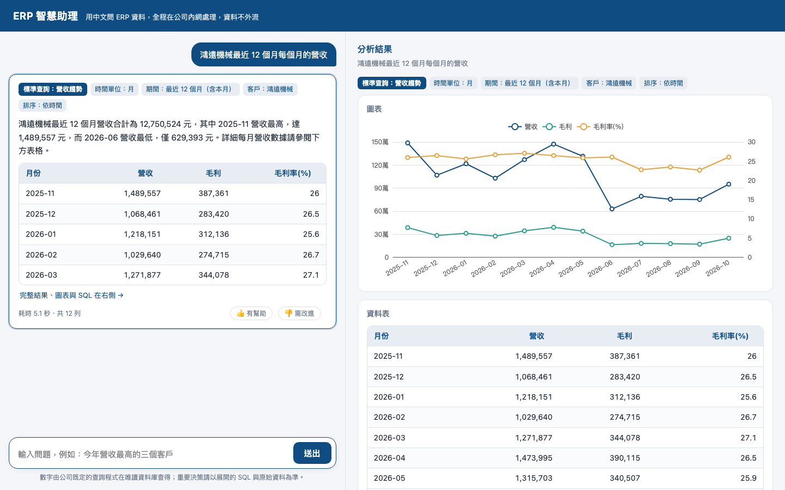
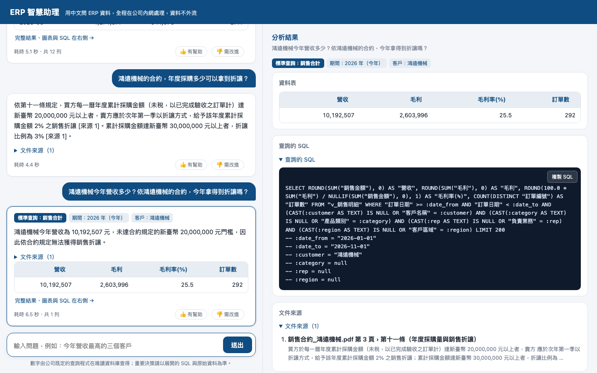

> 補充題：「鴻遠機械去年營收多少」→ 15,070,716 元。

## 劇本 2：毛利率怎麼掉了？（約 2 分鐘）

| 步驟 | 輸入 | 畫面 | 講稿 |
|---|---|---|---|
| 1 | 最近 18 個月每個月的毛利率 | 折線圖（營收、毛利、毛利率三條線）：毛利率一直在 25–26%，**2026 年 7–9 月掉到 22.5–22.8%** | 「原料漲價，第三季毛利率少了大約 3 個百分點。」 |
| 2 | 哪個客戶今年的營收比去年同期掉最多 | 表格第一列是全公司，再來是鴻遠機械（-2,320,192 元，-18.5%）、大興企業、宏發企業 | 「同期比較是公司寫死的標準查詢，上面的標籤就是 AI 填的參數，點開 SQL 可以核對。」 |

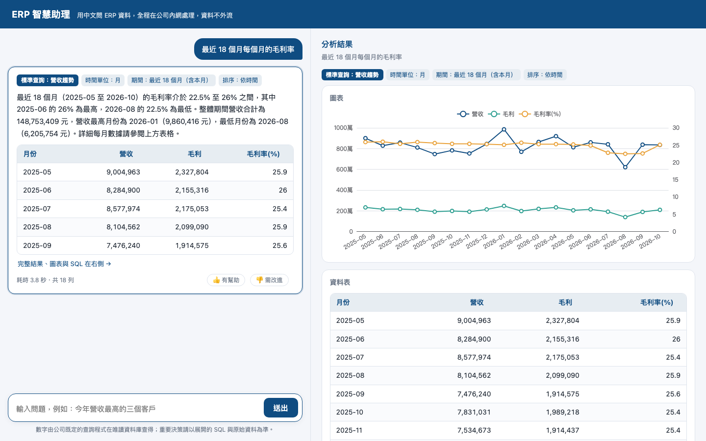
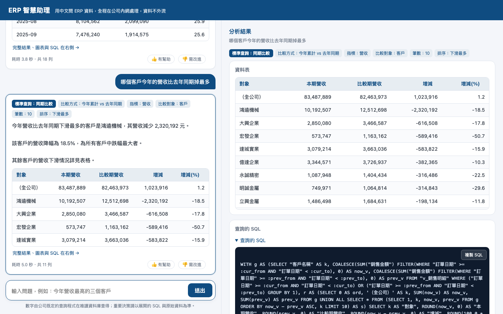

> 注意：「掉最多」是依**金額**排序。宏發企業的跌幅百分比（-50.7%）比鴻遠大，有人問的話照表格說明即可。

## 劇本 3：該去催收了，合約說可以停止出貨嗎？（約 3 分鐘）

| 步驟 | 輸入 | 畫面 | 講稿 |
|---|---|---|---|
| 1 | 應收帳款的帳齡分佈 | 長條圖：未到期 70.8%、逾期 1–30 天 12.6%、31–60 天 14.3%、61 天以上 4 張 274,239 元 | 「61 天以上的只有 4 張，看是誰的。」 |
| 2 | 台陽科技有哪些發票逾期 | 9 張逾期，合計 361,189 元；最久 136 天，前 3 張都超過 60 天 | 「逐張發票都列出來，可以直接拿去對帳。」 |
| 3 | 依合約，台陽科技逾期多久我們可以暫停出貨？信用額度多少？ | 任一張發票逾期超過 60 日可暫停出貨；信用額度 500,000 元，超過也可暫緩出貨；附合約來源 2 筆 | 「已經有 3 張超過 60 天，依合約我們可以停止出貨了，業務去談的時候有依據。」 |

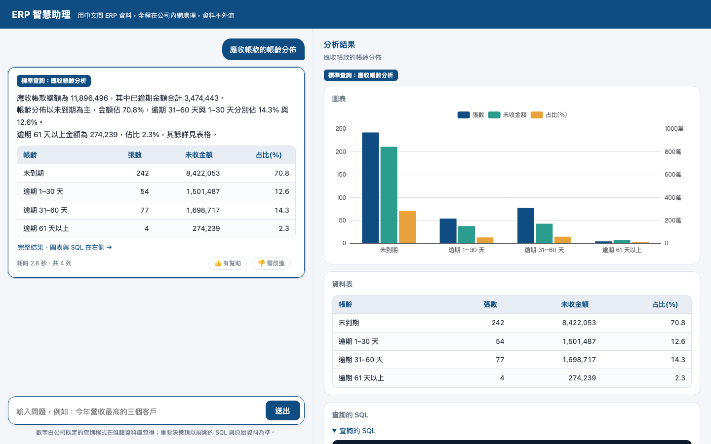
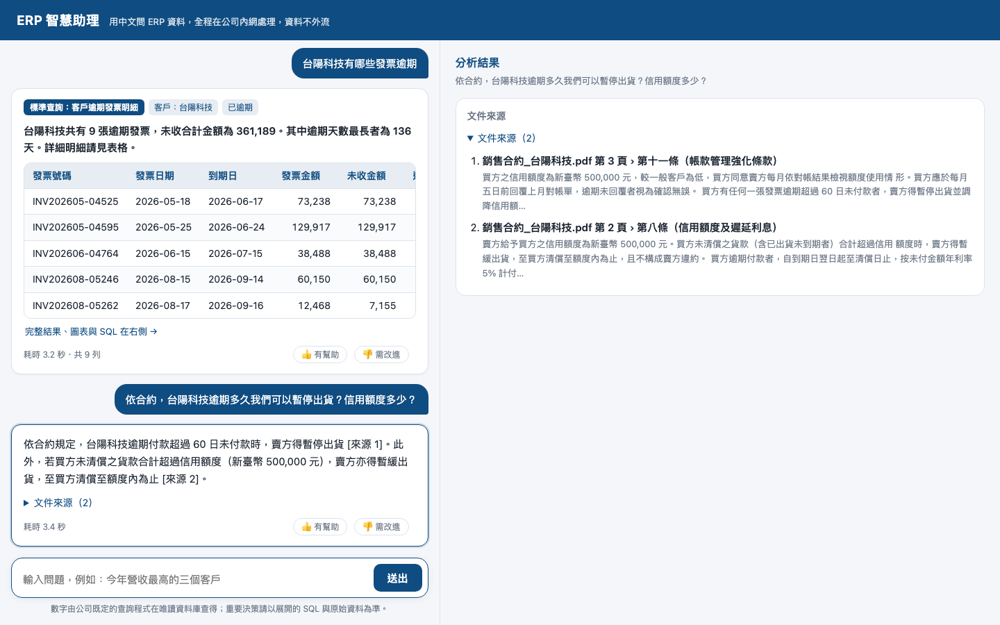

> 一句話版（備援）：「台陽科技逾期的應收有多少？依合約可以暫停出貨了嗎？」→ AI 會自己判斷「最長逾期 136 天，已超過 60 日，依合約可以暫停出貨」。
> 這題的合計是 361,188 元，和步驟 2 的 361,189 元差 1 元：步驟 2 是每張發票先四捨五入再相加，這題是先相加再四捨五入。

## 劇本 4：缺料救火，供應商延遲可以扣多少？（約 3 分鐘）

| 步驟 | 輸入 | 畫面 | 講稿 |
|---|---|---|---|
| 1 | 依目前待出貨訂單，哪些料號會缺料？建議採購多少？ | 3 個料號：FST-M8x30-HEX 建議 9,581、GEAR-M2-40T 建議 819、BRG-6204-2RS 建議 722；含供應商與交期 | 「GEAR-M2-40T 的供應商是精密熱處理，交期 28 天。」 |
| 2 | 各供應商的準時交貨率 | 橫條圖：億豐表面處理 20.1% 最低，**精密熱處理 25.8% 第二低** | 「偏偏交期最長的那家，準時率也很差。」 |
| 3 | 精密熱處理依合約標準交期幾天？延遲交貨我們可以怎麼扣款？ | 標準交期 28 日；每逾一日扣 0.6%、上限 10%、可自應付貨款抵銷；逾 30 日可解約；來源「採購合約_精密熱處理.pdf 第 1、2 頁」 | 「下單時可以直接提醒供應商罰則。」 |
| 4 | GEAR-M2-40T 的材質與硬度是什麼？ | S45C 中碳鋼、HRC 28-32；來源規格書 | 「要找替代供應商時，規格書也能直接問。」 |

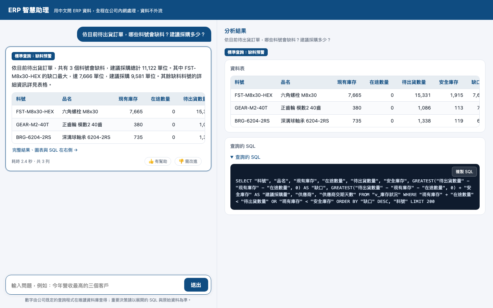
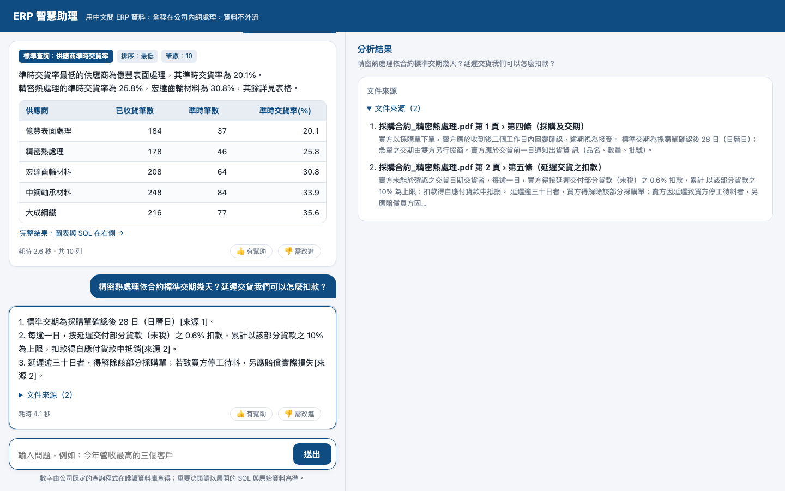

## 劇本 5：客訴現場，軸承異音怎麼處理？（約 2 分鐘）

| 步驟 | 輸入 | 畫面 | 講稿 |
|---|---|---|---|
| 1 | 客戶反映 6205-2RS 軸承異音，A 級客訴要多久內提出暫時對策？要用什麼報告回覆？ | 24 小時內提出暫時對策、以 8D 報告回覆；來源《SOP_客訴處理作業程序》 | 「新進品保也知道該怎麼做。」 |
| 2 | 6205-2RS 軸承的內外環硬度規格是多少？ | SUJ2、HRC 58-62，每批抽 3 件檢測；來源規格書 | 「回覆客戶前先確認規格。」 |
| 3 | BRG-6205-2RS 目前庫存多少 | 庫存 570 個，**最後異動 2026-03-31，已 214 天沒動** | 「順便發現這個料號是呆料，要換貨的話庫存夠，但也要檢查放太久的品質。」 |

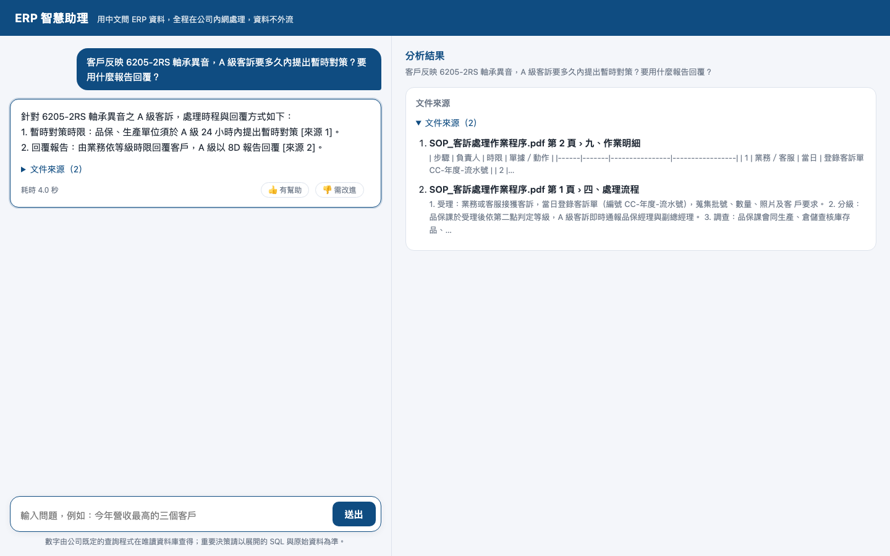
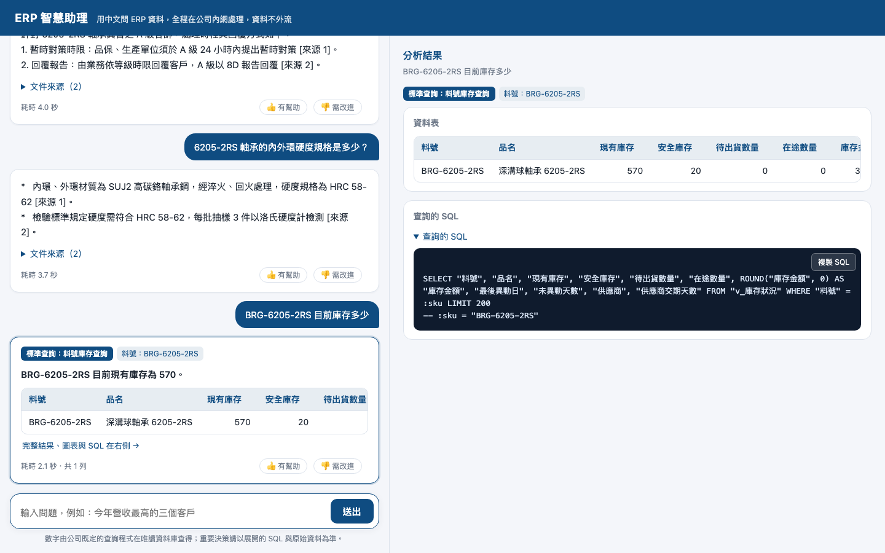

## 劇本 6：人資問答（約 1 分鐘）

| 步驟 | 輸入 | 畫面 |
|---|---|---|
| 1 | 我月薪 48,000，請事假 1 天要扣多少薪水？ | 扣 1,600 元（月薪 ÷ 240 × 8 小時）；來源《人資_請假與特休管理辦法》表 3 |
| 2 | 平日加班前兩小時的加班費倍率是多少？ | 1.34 倍、時薪 = 月薪 ÷ 240、30 分鐘為最小單位 |

講稿：「規章裡的表格也查得到，同仁不用再打電話問人資。」

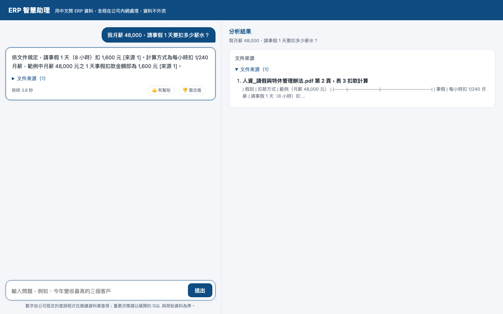

## 劇本 7：它不會亂查（約 1 分鐘）

| 步驟 | 輸入 | 畫面 | 講稿 |
|---|---|---|---|
| 1 | 各業務員今年的毛利率跟去年比 | 「您是要查下列其中一個嗎？」列出「同期比較」，⚠「指標不支援毛利率，改用營收」，按「執行這個」才查 | 「AI 不自己寫 SQL。沒有把握的時候，它會先跟你確認要用哪支程式、會得到什麼。」 |
| 2 | 各業務員的薪水是多少 | 婉拒，附可以改問的範例 | 「ERP 唯讀帳號本來就看不到薪資，問了也查不到。這類問題會被記錄，日後評估要不要做成新程式。」 |

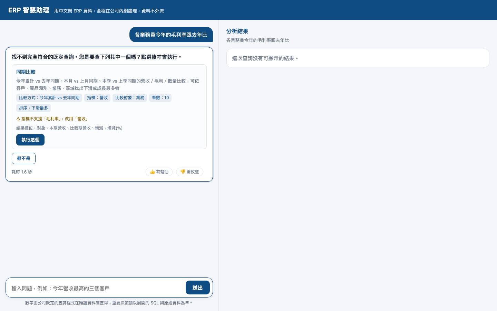

---

## 現場注意

- 劇本 1、3、4 都是**先看數字、再問文件**。最有感的是「AI 把 ERP 數字和合約條文兜在一起下結論」：劇本 1 步驟 3、劇本 3 的一句話版。
- 寬螢幕右側面板會顯示圖表、表格、SQL 與文件來源；點左邊任一張卡片可以切換。
- 如果數字回答變成很制式的一句話，代表 AI 的結論沒通過數字檢查，系統改用固定句型；數字仍然正確。
- 不要現場問「刪除」「修改」資料的問題：系統會婉拒，但目前的婉拒文字是「已記錄，之後會評估新增」，聽起來像是以後會支援改資料。
